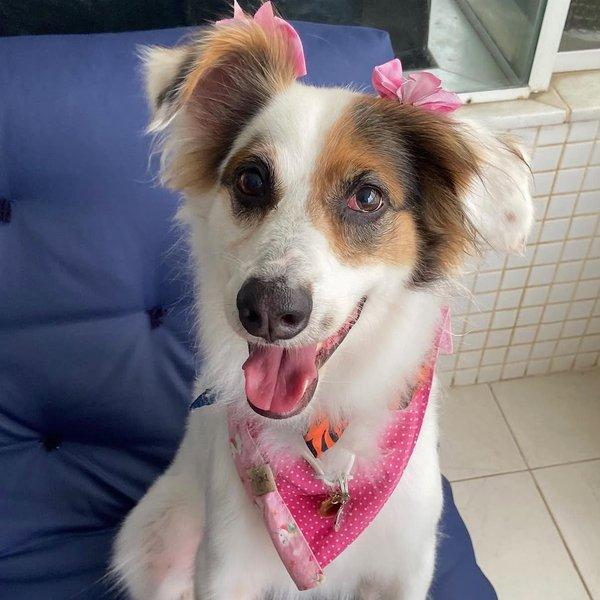

  

<a href="./README.md">English</a> · <b>Português</b>

  
  
  
  

## Sobre mim

- Engenheiro de software sênior, com atuação full stack desde 2021 em produtos de empresas da Dinamarca e da Alemanha e em um marketplace de crédito no Brasil.
- Aprendi a programar antes da popularização da IA para código, escrevendo tudo à mão. Arquitetura, testes, code review e investigação de bugs continuam sendo a base do meu trabalho.
- A IA me deixa mais rápido. Uso o Claude Code todos os dias, muitas vezes com vários agentes em paralelo, e coloco IA dentro do produto: análise por LLM, agentes com tool use e servidores MCP.
- Gosto de trabalhar perto do cliente: entrar na reunião, fechar o escopo e colocar um protótipo funcionando em produção em poucos dias.
- Inglês proficiente (C2). Fui professor de inglês por cinco anos e estudei na University of Manitoba, no Canadá, com bolsa de um programa seletivo.
- Mestre pela UFBA e ex-fonoaudiólogo.

## Experiência

### Antecipa Fácil · Engenheiro de software full stack
*dez 2022 a atual · Brasil, remoto*

Marketplace de crédito em que empresas antecipam recebíveis por leilão reverso entre financiadores.

- Criei do zero o app do cliente e os módulos centrais do backoffice.
- Construí a análise por LLM do chat entre empresas e financiadores: resumo, sentimento, respostas sugeridas e alertas de compliance, com fallback entre provedores.
- Levei o chat do monólito Django para um microserviço próprio, com autenticação entre serviços, Celery e roteamento pelo Azure APIM.
- Fiz o novo onboarding de ponta a ponta: cerca de 40 telas atrás de feature flag, login com Google e Microsoft, OCR de documentos, endpoints no backend e analytics de produto.
- Levei Husky, ESLint, Storybook, Vitest e Playwright para os fronts e escrevi cerca de 130 arquivos de teste.

`Next.js` `React` `TypeScript` `Python` `Django` `PostgreSQL` `Celery` `Azure` `OpenAI` `Anthropic` `PostHog`

### Miinto · Frontend engineer
*fev 2025 a ago 2026 · Dinamarca, remoto*

Marketplace de moda que conecta boutiques independentes e marcas a clientes em vários países da Europa.

- Mantive e ampliei o design system em React (Stitches, Radix, Storybook, Jest) usado pelos micro-frontends da loja.
- Redesenhei a listagem de produtos (filtros, busca no filtro, filtro de preço, ordenação, mobile) e a área logada (cadastro, login, perfil), integradas aos micro-frontends em Go com SSR.
- SEO técnico nas páginas renderizadas em Go, com regras de indexação por paginação e por combinação de filtros, e conteúdo legal em 12 canais de venda.
- Entreguei de ponta a ponta o histórico de e-mails do pedido no backoffice com Module Federation, com preview e reenvio.

`React` `TypeScript` `Go` `Stitches` `Radix` `Storybook` `Module Federation` `Jest`

### The Vintage Bar · Frontend engineer
*ago 2024 a fev 2025 · Dinamarca, remoto*

Marketplace de moda de luxo, hoje parte da Miinto. Filtros dinâmicos, gestão de estoque e integrações com o backend em Angular, TypeScript, PHP e Shopify.

### Antes

- **Engel & Völkers**, Berlim, remoto (2022): home do Smart Money em React, GraphQL, DatoCMS e Auth0, migrada para Next.js.
- **Taghos Tecnologia** (2021): checkout de assinatura do Paulistão Play em React, TypeScript, Formik e Cypress.
- **Saúde e ensino** (2011 a 2021): fonoaudiólogo em UTI neonatal, pediátrica e adulta e professor de inglês. Em 2020, como product owner, liderei um PWA de acompanhamento de pacientes feito com React e Firebase.

## Projetos para clientes (PJ, 2026)

| Projeto | O que eu fiz |
| --- | --- |
| **Checkout de curso online para uma escola de trânsito** | No ar em 10 dias. Na apresentação ao cliente, mudamos o plano juntos: vender primeiro, testar a demanda e construir a plataforma de aulas depois. Checkout no Asaas com PIX, cartão e split da comissão, webhooks idempotentes e conversão do Google Ads movida para o servidor com o GA4 Measurement Protocol. |
| **Agente de IA para pedidos B2B** | Transformei um processo manual em 7 ferramentas do agente: ler pedidos no e-mail, extrair PDF e Excel, conferir estoque e criar rascunho de pedido no Shopify, com revisão humana antes de confirmar. Protótipo em 5 dias com o SDK da Anthropic e SSE, mais uma versão em LangGraph para comparar as abordagens. |
| **Plataforma de aulas ao vivo (SaaS)** | Dev principal. Sala de vídeo da 100ms como sub-app Vite ao lado do React 19, avisos pelo WhatsApp Cloud API, pagamentos e afiliados no Asaas, papéis com o Clerk e monitoramento com PostHog e Better Stack. Orientei um dev júnior. |
| **ERP multi-tenant de e-commerce** | Responsável pelo front-end. Traduzi o app para inglês e mandarim com 17 agentes de IA em paralelo (2.569 chaves, paridade conferida por script), migrei o front para a API NestJS com tipos gerados do OpenAPI e corrigi a corrida de refresh token que derrubava a sessão. |

## IA aplicada

- **Agentes e tool use:** agentes no SDK da Anthropic e no LangGraph, saída estruturada validada com Zod, prompt caching, streaming por SSE e revisão humana onde importa.
- **Servidores MCP:** um em Python (FastMCP, stdio e HTTP com token) para registrar horas pelo Claude, outro em Node que sincroniza um board de bugs com o Notion, e um agente LangGraph consumindo um servidor MCP próprio.
- **IA na saúde (em desenvolvimento):** assistente que acompanha pacientes de terapia entre as sessões, com um modelo roteador, um gerador e um revisor que reprova ou reescreve a resposta, filtro de segurança determinístico e transcrição de áudio com Whisper.
- **Claude Code sob medida:** subagente que contesta a solução antes de codar com evidência do repositório, hook que usa o compilador TypeScript para barrar padrões proibidos, skills de fluxo de PR e workflows de verificação com mais de 100 subagentes.

## Projetos pessoais

Party games e ferramentas que eu jogo com os amigos toda semana. Cada um foi do primeiro commit à produção em 2 a 9 dias, com Next.js 16, React 19, Tailwind 4, Supabase e Vitest (cerca de 750 testes no total).

| App | O que é | Jogar | Código |
| --- | --- | --- | --- |
| **Vitrola** | Jogo musical: ouve 30 segundos de prévia do Deezer e encaixa a música na sua linha do tempo | [a-vitrola.vercel.app](https://a-vitrola.vercel.app) | [vitrola](https://github.com/luanmagalhaes/vitrola) |
| **Cantarolá** | Party game musical em times, com modo online que transmite o áudio do microfone | [cantarola.vercel.app](https://cantarola.vercel.app) | [cantarola](https://github.com/luanmagalhaes/cantarola) |
| **Não Vale** | Palavras proibidas, com o juiz do time adversário vendo a carta no próprio celular | [nao-vale.vercel.app](https://nao-vale.vercel.app) | [nao-vale](https://github.com/luanmagalhaes/nao-vale) |
| **FLOW** | Cada um escreve o que acha que a mesa vai escrever, de 3 a 12 jogadores, cada um no seu celular | [flow-seven-amber.vercel.app](https://flow-seven-amber.vercel.app) | [flow](https://github.com/luanmagalhaes/flow) |
| **De Fininho** | Cada jogador tem frases secretas para encaixar na conversa sem ninguém perceber | [de-fininho.vercel.app](https://de-fininho.vercel.app) | [de-fininho](https://github.com/luanmagalhaes/de-fininho) |
| **Flip Score** | Placar para as noites de cartas, com a foto de quem está jogando | [flip-score.vercel.app](https://flip-score.vercel.app) | [flip-score](https://github.com/luanmagalhaes/flip-score) |
| **La Cuentita** | Faz a conta da mesa na noite de cartas, sem calculadora | [la-cuentita-green.vercel.app](https://la-cuentita-green.vercel.app) | [la-cuentita](https://github.com/luanmagalhaes/la-cuentita) |

## Ferramentas

**Engenharia**

  
  
  
  
  
  
  
  
  
  
  
  
  
  
  
  
  
  
  
  
  
  
  
  
  

**IA**

  
  
  
  
  
  
  

## Formação

- Mestrado em Processos Interativos dos Órgãos e Sistemas, UFBA (2022)
- Tecnologia em Sistemas para Internet, Unicesumar
- University of Manitoba, Canadá: intercâmbio em Ciências da Saúde com bolsa de programa seletivo e curso intensivo de inglês (2014 e 2015)
- Fonoaudiologia, UNEB (2015)

## Idiomas

-16A34A?style=for-the-badge)

## Matilda

Essa é a Matilda, minha cachorra. Curiosidade: ela é vidente.

<picture>
  <source media="(prefers-color-scheme: dark)" srcset="https://raw.githubusercontent.com/luanmagalhaes/luanmagalhaes/output/snake-dark.svg" />
  <source media="(prefers-color-scheme: light)" srcset="https://raw.githubusercontent.com/luanmagalhaes/luanmagalhaes/output/snake.svg" />
  
</picture>

